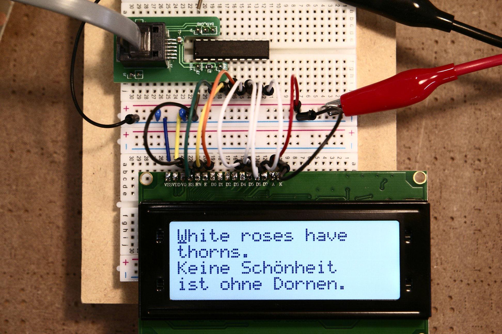

# HD44780 4-bit LCD Driver 

A lightweight, highly portable C driver for the Hitachi HD44780-compatible character LCD controller. This driver 
is optimized for resource-constrained microcontrollers and operates exclusively in **4-bit mode**.

*I originally wrote this for my own projects, but I've cleaned it up here for anyone else who needs a 
no-nonsense LCD driver.*



## 🚀 Overview

The driver is designed with a strict separation of concerns to ensure maximum portability across any 
MCU architecture.

### Architecture
1.  **Driver Layer (`lcd.c`, `lcd.h`)**: Contains the high-level logic for sending commands and writing 
characters. This layer is hardware-agnostic and communicates with the hardware via function callbacks.
2.  **Hardware Abstraction Layer (HAL)**: The user implements the hardware-specific logic (pin toggling, delays, 
etc.) within their own application code (e.g., `main.c`). 

> [!IMPORTANT]
> Function prototypes marked as `extern` in `lcd.h` must be implemented in the user code. The project will not 
compile until these required callback functions are provided in the application.

---

## 🛠 Usage and Implementation

Implementation can be approached in one of two ways, depending on whether the LCD's **Busy Flag** is used for 
timing management.

### Option 1: Minimal Implementation (No Busy Flag)
This mode is ideal for saving GPIO pins. It requires the `R/W` pin on the LCD to be permanently tied to **Ground 
(LOW)**.

**Required Callbacks:**
The following functions need to be implemented:

```c
// Hardware-specific delays
extern void lcd_delay_execute(lcd_delay_t type);

// Control pin manipulation
extern void lcd_rs_set(lcd_pin_state_t set_pin_state);
extern void lcd_en_set(lcd_pin_state_t set_pin_state);

// Data bus manipulation (4-bit mode)
extern void lcd_D4_set(lcd_pin_state_t set_pin_state);
extern void lcd_D5_set(lcd_pin_state_t set_pin_state);
extern void lcd_D6_set(lcd_pin_state_t set_pin_state);
extern void lcd_D7_set(lcd_pin_state_t set_pin_state);
```

**Note:** All pins must be configured as **outputs** in the microcontroller's GPIO initialization.

#### Example Implementation (PIC18F16Q41)
```c
// Sets/clears the RS pin
void lcd_rs_set(lcd_pin_state_t set_pin_state) {
    LATBbits.LATB4 = (set_pin_state == LCD_PIN_STATE_HIGH) ? 1 : 0;
}

// Sets/clears Data Bit 4
void lcd_D4_set(lcd_pin_state_t set_pin_state) {
    LATCbits.LATC4 = (set_pin_state == LCD_PIN_STATE_HIGH) ? 1 : 0;
}

// Hardware-specific delays required by the LCD controller
void lcd_delay_execute(lcd_delay_t type) {
    switch (type) {
        case LCD_DELAY_POWER_ON:     __delay_ms(50);  break;
        case LCD_DELAY_FUNCTION_SET: __delay_us(100); break;
        case LCD_DELAY_ENABLE_PULSE: __delay_us(1);   break;
        case LCD_DELAY_STANDARD:     __delay_us(40);  break;
        case LCD_DELAY_LONG_COMMAND: __delay_us(1520);  break;
        default:                     __delay_us(100); break;
    }
}
```

---

### Option 2: Advanced Implementation (With Busy Flag)
This mode utilizes the `R/W` pin to sense the controller's status.

**Required Callbacks:**
Includes all functions from **Option 1**, plus:

```c
// Controls the R/W pin
extern void lcd_rw_set(lcd_pin_state_t set_pin_state);

// Returns true if the Busy Flag is HIGH, false if LOW
extern bool lcd_D7_read_busy_flag(void);

// Switches the data bus between Input and Output modes
extern void lcd_set_data_bus_direction(lcd_bus_dir_t bus_dir);
```

#### Example Implementation (PIC18F16Q41)
```c
bool lcd_D7_read_busy_flag(void) {
    return (PORTCbits.RC7 != 0);
}

void lcd_set_data_bus_direction(lcd_bus_dir_t bus_dir) {
    if (bus_dir == LCD_BUS_OUTPUT) {
        TRISC &= 0x0F; // D4 to D7 set as outputs
    } else {
        TRISC |= 0xF0; // D4 to D7 set as inputs
    }
}
```

---

## 💡 Hardware Considerations

### Contrast and Voltage ($V_{O}$)
Upon power-up, the LCD should ideally display faint black blocks on the first line. If the screen remains blank:
* **5V Systems:** A potentiometer should be used on the $V_{O}$ pin to adjust contrast.
* **3.3V Systems:** Many LCDs require a negative voltage on $V_{O}$ to achieve sufficient contrast. Unless the 
controller includes a built-in negative charge pump, an external negative voltage source may be necessary.

---

## ⏱ HD44780 Timing Specifications

*Note: These are common minimum requirements. Always consult the specific datasheet for your LCD controller.*

### 1. Initialization Timings
| Parameter | Symbol | Minimum Value | Description |
| :--- | :--- | :--- | :--- |
| **Power-on Delay** | $t_{PO}$ | 15 ms | Delay from stable VCC to first command |
| **Initialization 1** | $t_{INIT1}$ | 4.1 ms | Delay after first "Function Set" command |
| **Initialization 2** | $t_{INIT2}$ | 100 µs | Delay after second "Function Set" command |
| **Initialization 3** | $t_{INIT3}$ | 40 µs | Delay after third "Function Set" command |

### 2. Command and Data Timings
| Parameter | Symbol | Minimum Value | Description |
| :--- | :--- | :--- | :--- |
| **Execution Time** | $t_{EXEC}$ | 37 µs | Standard command/data execution time |
| **Clear/Home Delay** | $t_{CD/H}$ | 1.52 ms | Execution time for Clear Display and Return Home |
| **Data Setup Time** | $t_{AS}$ | 80 ns | Time data must be stable before EN goes High |
| **Data Hold Time** | $t_{AH}$ | 10 ns | Time data must remain stable after EN goes Low |

### 3. Control Signal Timings
| Parameter | Symbol | Minimum Value | Description |
| :--- | :--- | :--- | :--- |
| **Enable Pulse Width** | $t_{PW}$ | 450 ns | Duration the Enable (EN) pin must remain HIGH |
| **Enable Cycle Time** | $t_{CY}$ | 1 µs | Total time for one full Enable pulse cycle |

